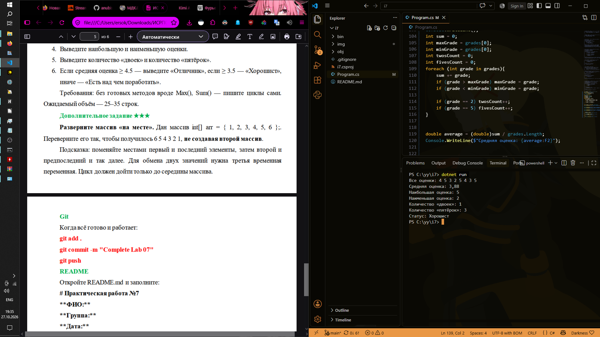
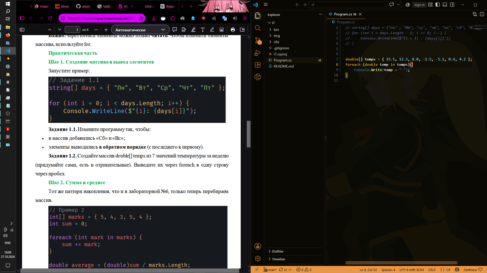

# ISRPO 7

**ФИО:** Чумаченко Михаил
**Группа:** ИСП-242

## Что изучено
- **Индексация элементов:** узнал, что нумерация элементов в массивах C# всегда начинается с нуля (0), а индекс последнего элемента равен `Length - 1`. Обращение к несуществующему индексу вызывает ошибку `IndexOutOfRangeException`.
- **Цикл foreach:** научился использовать его для быстрого и удобного перебора всех элементов массива. Понял главное ограничение — через `foreach` элементы можно только читать, но нельзя изменять.
- **Модификация и поиск с for:** освоил применение классического цикла `for`, когда требуется изменять значения элементов по их индексу, выводить данные в обратном порядке или отслеживать точную позицию (индекс) элемента при поиске.

## Скриншоты

